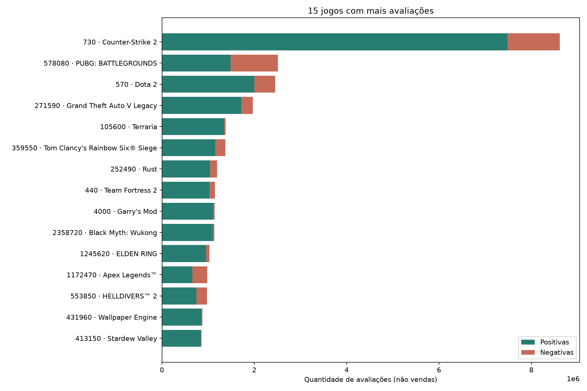
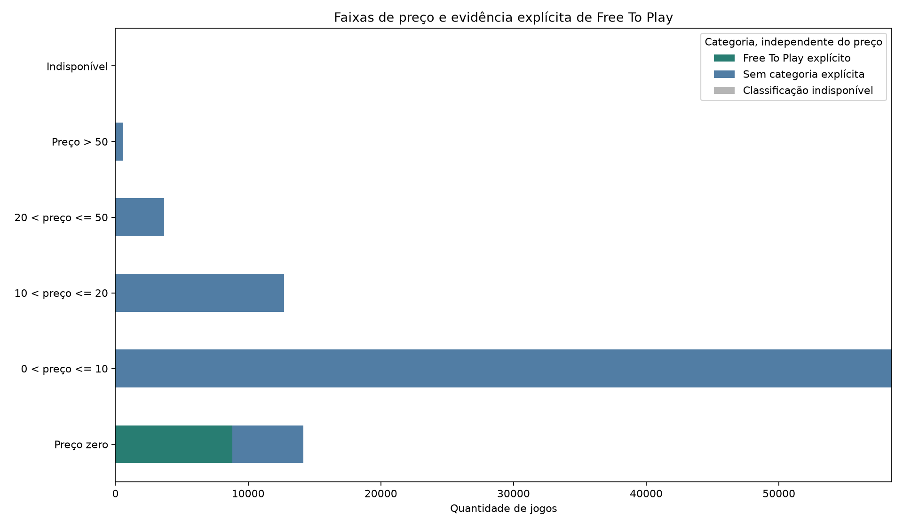
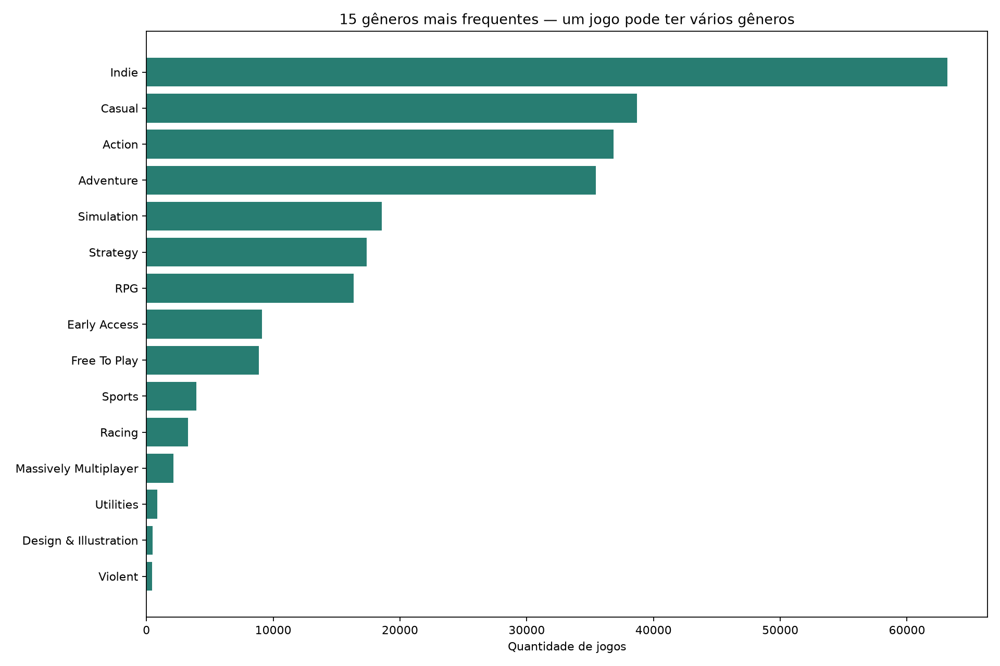
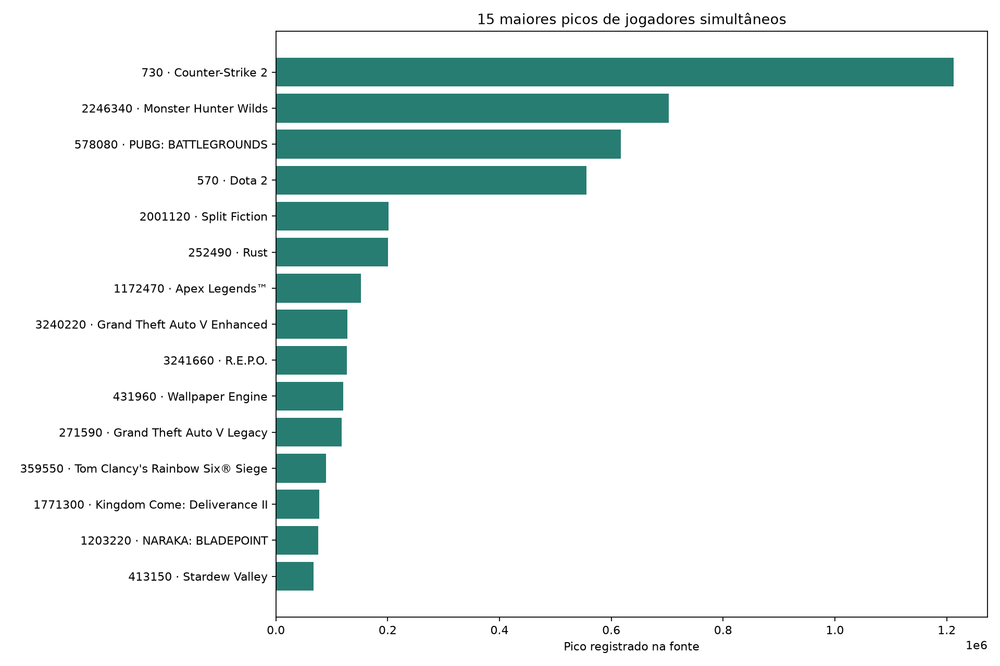

# Evidências selecionadas — N3 SaveMe Games

Dados: snapshot Steam/março de 2025. Preparação e consultas: **17/11/2026**.
Enunciado: implementar o pipeline da N2, demonstrar funcionamento e saídas,
apresentar em 17/11, publicar código no GitHub e fornecer instruções.

## O que foi realmente executado

- **89.618 documentos**, 89.618 appids distintos, **zero duplicados**, índice único.
- **70 testes aprovados novamente** na preparação desta apresentação; sem servidor
  necessário para os testes unitários, que usam fixtures e mocks nos casos de banco.
- Reprodução limpa do commit `6300343`: nova venv, MongoDB separado em **27018**,
  15 CSVs iguais byte a byte aos originais, 14 PNGs e três resumos analíticos.
- Coleção e índices permaneceram intactos na coleta atual, com hash BSON igual
  antes/depois. A carga não foi reexecutada durante esta preparação.

Fonte verificável e estrutura da evidência:
[execucao_validada.json](execucao_validada.json). O arquivo diferencia consultas
atuais de registros históricos da reprodução, sem inventar uma nova carga.

## Carga inicial e segunda execução

Resultado real da reprodução limpa, inicialmente vazia:

| Execução | Inseridos | Modificados | Inalterados | Rejeitados |
|---|---:|---:|---:|---:|
| Primeira | 89.618 | 0 | 0 | 0 |
| Segunda | 0 | 0 | 89.618 | 0 |

Idempotência e igualdade do estado final: **comprovadas**. A primeira carga levou
123,793 s e a segunda 131,159 s; o comando completo levou aproximadamente 327 s
incluindo consultas e hashes. Esses tempos são daquela execução, não promessas
de desempenho nem medições de uma nova carga durante a apresentação.

Upsert ainda envia comandos de escrita na segunda execução. Zero modificações
significa que o servidor reconheceu os mesmos documentos; o relatório também
confere o hash de todo o estado, e não apenas a quantidade de documentos.

## Quatro gráficos reais, sem edição

Copiados de `outputs/analises/`; origem e hashes em
[graficos_proveniencia.json](graficos_proveniencia.json).

### Avaliações

Counter-Strike 2: **8.615.921 avaliações**, sendo 7.480.813 positivas e 1.135.108
negativas. Avaliações não são vendas. Este gráfico ordena pelo total, não apenas
por positivas; há ranking separado de positivas no script `analises_finais.py`.

### Preços

**14.160 preços zero**, **8.867** classificações Free To Play explícitas.
Preço zero não equivale à categoria; há 5.365 preços zero sem a classificação
explícita. A moeda não foi presumida. Há 7.454 jogos com desconto (8,32%).

### Gêneros

Indie: **63.189 jogos**. Um jogo pode ter vários gêneros; não somar os grupos
como se fossem jogos distintos. A comparação de preço e avaliação por gênero
também existe em `analises_finais.py`.

### Popularidade

Counter-Strike 2: pico de **1.212.356** jogadores simultâneos na fonte.
Isso não representa usuários atuais nem vendas.

## Exemplos reais minimizados

[documentos_reais.json](documentos_reais.json) contém **duas projeções pequenas**
consultadas no MongoDB real de reprodução: appid 730 e um jogo sem avaliações,
appid 12370, que demonstra taxa `null` por denominador zero.

Não são documentos completos nem registros fictícios. Foram excluídos `_id`,
contatos, URLs, descrições livres e quaisquer dados de usuários. Os nomes e
appids públicos dos jogos foram mantidos para permitir conferir a consulta.
Não existem dados pessoais de jogadores nesses exemplos.

## Fonte do dataset e limites

[Correspondência verificada](correspondencia_dataset.json) e
[origem e download](../ORIGEM_DATASET.md): Kaggle `artermiloff/steam-games-dataset`,
versão 2. O CSV completo não integra esta pasta nem o Git.

Os resultados são descritivos e se referem ao snapshot. Não se inferem moeda,
unidade de tempo, causalidade, vendas exatas, outras lojas ou histórico de preços.
Hipóteses de sentinelas e a distinção entre preço zero/F2P continuam documentadas.
Se Docker/internet falharem, estes arquivos são evidências de execução anterior,
não devem ser apresentados como consulta ao vivo.
